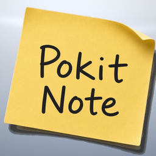

<h1>
&nbsp; &nbsp; Pokit Note Cursor Plugin
</h1>

This is the Cursor plugin for Pokit Note (pronounced 'Pocket Note'). Pokit Note enables collaboration with Grok Bot from your phone on to-do lists, shopping, notes, recipes and more.

Pokit Note is currently only available for iPhone, and only in the US. Android support coming soon.

## Install and Connect Grok Bot

Install the plugin through Cursor and connect Grok Bot to the Pokit Note app on your iPhone to share links and photos with agents and collaborate on updates.

1. **Install the Plugin** in Cursor.
   - **Now:** Open Settings > Open Customize > Marketplace. Click **Add Marketplace**, choose **Import from GitHub**, and enter https://github.com/botrelay-ai/pokitnote-cursor-plugin. Find the Pokit Note plugin and click the Add button to install it.
   - **Once Pokit Note is listed in the Marketplace:** Open Settings > Open Customize > Marketplace, search for "Pokit Note", and click Add to install it.
2. After the Pokit Note plugin is added, open it to access the configuration. Under MCPs, next to Pokit Note, click **Authenticate**. This will open the Pokit Note website in the default browser. If you don't already have an account, create one, and then sign in and choose **Approve** to complete the setup. You can also run `/pn-sign-in` in Cursor chat for these steps.
3. With the plugin authenticated and authorized, prompt your Grok Bot agent with the following: "Set up a routine that handles my Pokit Note Connected Assistant webhook, following the Pokit Note connected assistant skill." Grok Bot creates a routine that runs when Pokit Note calls its webhook.
4. Open the routine's settings in the Grok Bot sidebar and copy its Webhook URL and Webhook Key. **Note:** you may have to ask the agent for a link to the routine in order to access the Webhook URL and Webhook Key.
5. In the Pokit Note app on your iPhone, open Account, then Connected Assistant, and choose Grok Bot. Paste the URL and the key, tap Save, then tap Send Test. Grok Bot confirms it got the test.

## How to Collaborate With Grok Bot
In Safari, Photos, or any app, tap Share, choose Pokit Note, pick a quick prompt or type your own, and tap Send. Grok Bot handles it and tells you what it did.

- Recipe page: "Get the recipe from this page and add it to my recipes." Grok Bot saves it to Recipes with the ingredients sorted into grocery aisles, plus the steps.
- Article: "Summarize this page and create a note." You get a new note with a short summary and the link.
- Product page: "Add the item on this page to my shopping list." It goes on your grocery list in the right aisle.
- Photo of a dish: "Find the best recipe for this dish and add it to my recipes."
- Photo of something you're out of: "Identify this and add it to my shopping list."

Shared photos are stored privately and deleted after 7 days.

## Turn a Recipe Into a Shopping List

Ask Grok Bot in plain words:

- "Add the ingredients for Chicken Marsala to my Shopping list."
- "Add everything for Stuffed Bell Peppers to my grocery list except the rice."
- "I'm making Banana Bread and Chicken Marsala this weekend. Put what I need on my Shopping list."

Ingredients land in the right aisle with their amounts, like "Flour (2 cup)". Anything already on the list and not checked off is skipped, so adding the same recipe twice doesn't create duplicates. Grok Bot tells you what it added and what it skipped.

## Links

- Connect Grok Bot guide: https://pokitnote.com/connect/grok-bot
- Support: https://pokitnote.com/support
- Privacy: https://pokitnote.com/privacy
- Terms: https://pokitnote.com/terms
